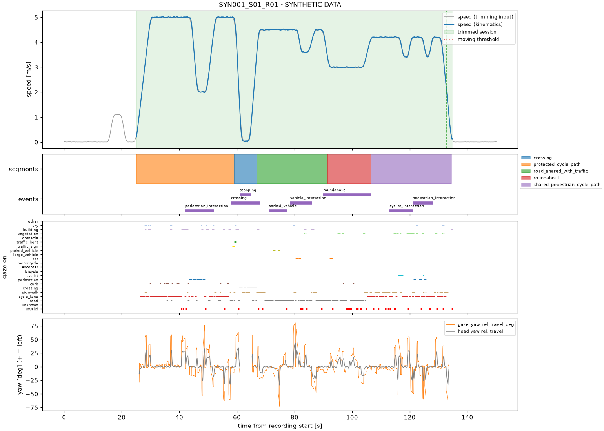

# AriaGenEScooter

Research codebase for a **naturalistic study of everyday e-scooter riding** with
**Meta Project Aria Gen 2** glasses: how infrastructure and surrounding traffic shape the rider's
**visual attention** and **riding behaviour**, whether riders show **consistent individual
patterns**, and how **what riders see precedes what they do** (perception -> action).

> Status (October 2026): **project foundation + tested MVP on synthetic data.** No real Aria
> recording has been processed yet. Ethics approval, final protocol and analysis plan are
> **TBD**. The table below separates what is implemented, tested, planned and TBD.

The study is **not** a crash or near-miss study: nothing is provoked, interactions are observed
as they happen, and riders are described with quantitative metrics, never labelled
"safe/unsafe".

## Research questions

1. How do infrastructure and surrounding traffic conditions influence visual attention and
   riding behaviour in e-scooter users?
2. Are there consistent rider-specific behavioural and visual-attention patterns across
   different urban contexts?
3. How does visual perception precede and relate to subsequent riding actions?

Unit of analysis: the **route segment** (protected cycle path, painted cycle lane, shared
pedestrian-cycle path, road shared with traffic, pedestrian/shared space, crossing,
intersection, roundabout), with overlapping **events/interactions** (pedestrian, cyclist,
e-scooter, vehicle, parked vehicle, obstacle, narrow section, overtaking, stopping...).
Details: [docs/research_questions.md](docs/research_questions.md).

## Implemented / tested / planned / TBD

| Component | Status |
|---|---|
| Portable configuration (YAML, strict validation, no hidden defaults), taxonomy | implemented, tested |
| Pseudonymous ids, session manifests, identifier scanner | implemented, tested |
| Timestamp validation (monotonicity, duplicates, gaps, rates) | implemented, tested |
| Synchronisation: gap-aware interpolation, nearest matching with tolerance, GPS clock-offset estimation | implemented, tested |
| Ride trimming (configurable rule, buffers, manual override, `trimming.json`) | implemented, tested |
| Kinematics and behaviour metrics (speed, acceleration, jerk, deceleration events, stops, lateral oscillation, approach windows) | implemented, tested |
| Semantic gaze (frame matching, label lookup, validity rules, shares, dwells, transitions, entropy, I-VT fixations, forward share, lateral glances, BCEA) | implemented, tested on synthetic data |
| Perception -> action (first gaze, anticipation, action onset, latency, max deceleration) | implemented, tested on synthetic data |
| Deterministic reports and tables, diagnostic figures, study-level aggregation | implemented, tested |
| Privacy utilities (data tiers, GPS protection, region blurring, anonymisation loop) | implemented, tested |
| Synthetic dataset generator with ground truth | implemented, tested (committed data reproduced by the generator) |
| Windows and Linux environments (uv.lock, setup scripts) | implemented, tested on Windows 11 and WSL Ubuntu 24.04 |
| Aria Gen 2 extraction (VRS -> canonical streams, gaze projection) | implemented against the official API (symbols verified on Linux); **not yet run on a real VRS** |
| MPS readers (closed-loop trajectory, Gen 2 eye-gaze CSV) | implemented, tested on documented-format fixtures |
| Semantic segmentation back-end (Hugging Face) + label mappings (Mapillary Vistas, Cityscapes) | interface/mappings tested; back-end **experimental, untested** |
| EgoBlur face/plate anonymisation of Gen 2 VRS | **planned** (separate environment prepared, not run) |
| Distance/clearance to interaction targets, steering responses, motion-compensated gaze lookup | **planned** |
| Mixed-effects models, riding-style clustering | **planned** (data structure ready) |
| Annotation guide and tool, route, sample size, recording profile, legal basis, DPIA, retention | **TBD** |

## Repository structure

```
AriaGenEScooter/
  README.md                  this file
  pyproject.toml, uv.lock    package metadata and universal lock file (Windows + Linux)
  setup_windows.ps1          create .venv on Windows and verify
  setup_linux.sh             create .venv on Linux (with projectaria-tools) and verify
  configs/
    default.yaml             every analysis parameter, documented
    taxonomy.yaml            infrastructure classes, event types, semantic classes
    example_session.yaml     documented session manifest
    label_mappings/          Mapillary Vistas / Cityscapes -> project classes
  src/ariagen_escooter/
    config.py  session.py  io.py  streams.py        configuration, ids/manifests, I/O, schemas
    synchronization.py  trimming.py  trajectory.py  time alignment, ride trimming, kinematics
    behaviour.py  gaze.py  events.py                metrics, semantic gaze, perception -> action
    segmentation.py  privacy.py  aria.py            scene parsing, privacy, Aria Gen 2 adapter
    visualization.py  reporting.py  pipeline.py     figures, reports, orchestration
    synthetic.py  cli.py  __main__.py               synthetic data, command line
  tests/                     unit, end-to-end and portability tests
  data/
    raw/ interim/ processed/ public/   data tiers (never versioned, only READMEs)
    synthetic/               SYNTHETIC / TEST DATA (versioned)
  docs/
    research_questions.md  methodology.md  data_schema.md  privacy_pipeline.md
    aria_gen2_integration.md  figures/
    ethics/ethics_study_overview.md  ethics/ethics_one_page.md   (Italian)
    presentation/AriaGenEScooter_overview.pptx  (+ build_presentation.py)
```

## Setup

The virtual environment is **machine specific**: never copy `.venv` between Windows and Linux.
Clone or copy the repository (without `.venv`) and run the setup script of that system. Both
scripts prefer [uv](https://docs.astral.sh/uv/) with the committed `uv.lock` (exact, tested
versions; Python 3.11 from `.python-version` is downloaded if needed) and fall back to
`venv + pip` (version ranges, not locked) if uv is missing. Supported Python: 3.10-3.12
(limit set by projectaria-tools).

**Windows** (analysis, synthetic data, documentation; no VRS processing):

```powershell
powershell -ExecutionPolicy Bypass -File .\setup_windows.ps1
```

Options: `-Extras "cv,presentation"`, `-Recreate`, `-SkipTests`, `-NoDev`, `-Python <path>`.
The `aria` extra is skipped automatically (projectaria-tools has no Windows wheels).

**Linux** (all stages, including Aria VRS extraction):

```bash
./setup_linux.sh
```

Installs core + `aria` (projectaria-tools 2.3.0) + `dev`, then runs `info` and the tests.
Options: `--extras aria,cv`, `--recreate`, `--skip-tests`, `--no-dev`, `--python PATH`,
`--egoblur` (separate `.venv-egoblur` for Meta EgoBlur, which cannot share the main environment).
Install uv with `curl -LsSf https://astral.sh/uv/install.sh | sh` or `pip install --user uv`.

Manual equivalent: `uv sync --frozen --extra dev` (Windows) / `uv sync --frozen --extra aria --extra dev` (Linux).

Extras: `aria` (projectaria-tools, Linux/macOS), `cv` (torch, torchvision, transformers, pillow,
OpenCV - experimental segmentation; large download on Linux), `dev` (pytest, ruff),
`presentation` (python-pptx, to rebuild the slide deck).

## Quick start: MVP on synthetic data (no Aria needed)

```bash
python -m ariagen_escooter info
python -m ariagen_escooter validate data/synthetic/SYN001_S01
python -m ariagen_escooter run data/synthetic/SYN001_S01
python -m ariagen_escooter aggregate --synthetic
```

`run` loads the synthetic session, validates timestamps, estimates and corrects the GPS clock
residual, detects the riding interval and trims, computes kinematics and semantic gaze, the
segment/event/perception-action metrics, and writes `data/processed/SYN001_S01/SYN001_S01_R01/`
(`report.json`, `trimming.json`, `tables/*.csv`, `figures/*.png`). On the synthetic session the
pipeline recovers the ground truth: riding interval within 0.1 s, GPS clock residual within
0.01 s, first gaze on targets within 0.15 s and deceleration onsets within 0.2 s.



*Diagnostic figure of the SYNTHETIC session: speed and trimming decision, route segments and
events, semantic class under the gaze, gaze and head yaw relative to the direction of travel.*

## Adding a real session

1. **Create the session folder** (pseudonym only):
   `python -m ariagen_escooter new-session --next` -> `data/raw/P001_S01/manifest.yaml`.
2. **Copy the recording** to `data/raw/P001_S01/P001_S01_R01/recording.vrs` (restricted storage).
3. **Complete the manifest** (route, conditions, equipment codes, technical issues, optional
   `trimming_override`). No names, e-mails or phone numbers: `validate` rejects them.
4. **Extract canonical streams** (Linux): `python -m ariagen_escooter extract-aria data/raw/P001_S01`
   -> `data/interim/P001_S01/P001_S01_R01/streams/` + `inventory.csv`; update stream statuses in
   the manifest.
5. **Anonymise** the video before viewing it (EgoBlur, `docs/privacy_pipeline.md`).
6. **Annotate** route segments and events (`annotations/segments.csv`, `events.csv`, format in
   `docs/data_schema.md`; times in ns or seconds from recording start).
7. **(Optional) label maps**: `segment-frames` (experimental) or any back-end writing
   `semantic/labels.npz`.
8. **Validate and run**: `validate data/raw/P001_S01`, then `run data/raw/P001_S01`.
9. **Aggregate** all real sessions: `python -m ariagen_escooter aggregate --participants <covariates.csv>`.

The data root can live on another disk: `export ARIAGEN_DATA_ROOT=/mnt/data/ariagen` (Linux) or
`$env:ARIAGEN_DATA_ROOT = "D:\ariagen"` (Windows).

## Naming conventions

| Entity | Pattern | Example |
|---|---|---|
| participant | `P001`..`P999` (`SYN001`.. for synthetic data) | `P007` |
| session | `<participant>_S<nn>` | `P007_S02` |
| recording | `<session>_R<nn>` | `P007_S02_R01` |
| segment / event | `<recording>_SEG<nnn>` / `<recording>_EV<nnn>` | `P007_S02_R01_EV012` |

Classes and event types are snake_case names from `configs/taxonomy.yaml`; column names carry
units (`_s`, `_ns`, `_m`, `_mps`, `_mps2`, `_deg`, `_px`).

## Pipeline

```
VRS --extract-aria--> canonical streams --validate--> timestamps OK
    --sync--> GPS clock residual, gaze <-> frames
    --trim--> raw session -> detected riding interval -> trimmed session (trimming.json)
    --kinematics--> speed, acceleration, jerk, deceleration events, stops, lateral oscillation
    --semantic gaze--> gaze point -> frame -> semantic class/object -> gaze metrics
    --segments/events--> per-segment, approach and per-event (perception -> action) tables
    --aggregate--> study-level long tables (rider x infrastructure)
```

Methods, parameters and limitations: [docs/methodology.md](docs/methodology.md).

## Configuration

All parameters are in [configs/default.yaml](configs/default.yaml) (documented, units in names,
provisional values marked). Override any subset with your own file:
`python -m ariagen_escooter run <session> --config my_overrides.yaml`. Unknown keys are errors;
the merged configuration and its SHA-256 are saved with every run.

## Data and privacy rules (summary)

- `data/raw`, `data/interim`, `data/processed`, `data/public` are never versioned; VRS, video,
  audio and model files are ignored everywhere.
- Original data are never modified or deleted by the code.
- Pseudonyms only; the identity key stays outside the repository.
- Faces and licence plates are anonymised before viewing/sharing; GPS endpoints and private
  zones are removed or generalised before sharing; MPS (cloud upload) is not used by default.

Details: [docs/privacy_pipeline.md](docs/privacy_pipeline.md); ethics committee documents (Italian):
[docs/ethics/ethics_study_overview.md](docs/ethics/ethics_study_overview.md),
[docs/ethics/ethics_one_page.md](docs/ethics/ethics_one_page.md).

## Tests

```bash
python -m pytest -q          # ~130 tests, ~15 s, no hardware or real data needed
python -m ruff check src tests
```

Covered: path portability (no absolute paths in the repository), configuration loading and
strictness, ids and manifests, privacy scanner and GPS/blur utilities, timestamp validation and
synchronisation, trimming, kinematics and behaviour metrics, semantic gaze, events and
perception -> action, segmentation interfaces, MPS readers, end-to-end correctness against the
synthetic ground truth, deterministic outputs, CLI, documentation consistency. On Linux the
projectaria-tools API surface used by the extractor is also checked.

## Tested environments

| System | Python | Notes |
|---|---|---|
| Windows 11, `setup_windows.ps1` (uv + uv.lock) | 3.11.15 | all tests pass (aria test skipped) |
| WSL Ubuntu 24.04, fresh `git clone` + `setup_linux.sh` | 3.11.16 | projectaria-tools 2.3.0 installed; all tests pass; MVP tables byte-identical to Windows |

## Documentation

| Document | Content |
|---|---|
| [docs/research_questions.md](docs/research_questions.md) | research questions, operationalisation, status |
| [docs/methodology.md](docs/methodology.md) | design, sensors, pipeline, algorithms, parameters, validation, references |
| [docs/data_schema.md](docs/data_schema.md) | ids, folders, conventions, file formats, outputs |
| [docs/privacy_pipeline.md](docs/privacy_pipeline.md) | data tiers, pseudonymisation, bystanders, anonymisation, GPS, MPS, sharing |
| [docs/aria_gen2_integration.md](docs/aria_gen2_integration.md) | verified Gen 2 facts (SDK, streams, time, calibration, MPS), pilot checklist |
| [docs/ethics/](docs/ethics/) | ethics committee overview and one-page summary (Italian) |
| [docs/presentation/](docs/presentation/) | short overview deck for the project lead |

## Before the first pilot

Ethics approval and DPO review (legal basis, DPIA, retention, bystander notice); final route
(legal e-scooter infrastructure, no sensitive places) and recording profile (ideally without
audio); helmet compatible with the glasses; e-scooter registration sticker and insurance as
required by Italian rules; EgoBlur model download; annotation guide; first real VRS to validate
`extract-aria` (checklist in `docs/aria_gen2_integration.md`).

## License and citation

**TBD** (to be decided by the project lead and the institution).
